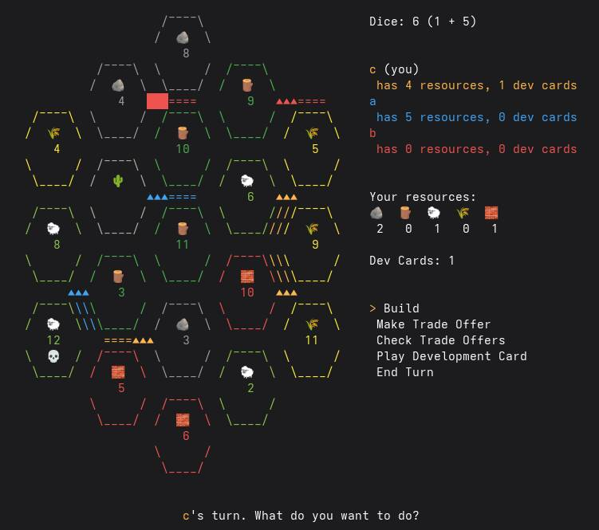

# El Poblador - Settlers of Catan TUI

[](https://github.com/VichoReyes/el-poblador/actions/workflows/ci.yml)

A terminal-based implementation of Settlers of Catan in Go.



## Installation

Download the latest release for your platform from [GitHub Releases](https://github.com/VichoReyes/el-poblador/releases/latest). Alternatively, you can run `go install github.com/VichoReyes/el-poblador@main`.

Use `@main` when installing with Go until a release is tagged with the GitHub module path. The installed binary is named `el-poblador`.

Another option is cloning the repo and building from [source](https://github.com/VichoReyes/el-poblador). Or making an AUR package. Go wild.

## Running the Project

The examples use `go run .`, but if you have a compiled binary use that instead.

Run the main game with 3-4 players:

```bash
go run . new <player1> <player2> <player3> [player4]  # player names
```

Load a saved game:

```bash
go run . load <savefile>
```

**Controls:**
- Arrow keys: Move cursor
- Enter: Confirm action
- Esc: Cancel action (not always available)
- 1-4: Switch to specific player's perspective
- 0: Switch back to current turn holder's perspective
- Ctrl+C: Quit game without saving

## Online Multiplayer

There's a hosted version, so you only need to connect to see players.

```bash
$ ssh catan.vichoreyes.cl -p 2222  # to see open lobbies
```

It's on GCP, as documented on
[the deployment guide](deploy/gcp/README.md).

Connections open a lobby browser. Use the arrow keys to select a lobby and
Enter to join, or press `n` to create a named lobby.
In a lobby, press Enter to signal you're ready and want the game to start (if the lobby has 3 players all ready, it won't wait for a 4th one).

Choosing **Save & Quit** pauses the shared game and shows every connected player
a save code. Keep that code and reconnect with your original SSH username:

```bash
ssh -t -p 2222 yourname@catan.vichoreyes.cl resume YOUR_SAVE_CODE
```

Everyone uses the same code. The game resumes once all original players have
connected and marked themselves ready. Saves expire 30 days after saving.
Rejoining an unsaved game already in progress is not supported yet.

Self-hosted servers keep snapshots in `saves/` under their working directory,
with a 64 MiB total limit and a 1 MiB limit per save. Saving again replaces the
same game's snapshot and renews its expiry. Expired saves are removed on the
next save; if storage is full or a write fails, the game stays open.

### Self host

Start a server with

```
$ go run . serve
2026/08/01 17:50:49 starting server at 127.0.0.1:2222
```

then players can connect with

```
$ ssh username@<host> -p 2222
```

Options for the server can be checked with

```
$ go run . serve -help
```

This feature is in its early stages and as such has a bunch of
[rough edges](https://github.com/VichoReyes/el-poblador/issues?q=is%3Aissue%20is%3Aopen%20label%3Assh).
Please send pull requests or [bug reports](https://github.com/VichoReyes/el-poblador/issues).

## License

EUPL v1.2
